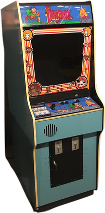
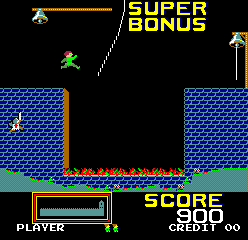

# Hunchback (CVS, 1983) for MiSTer FPGA

An FPGA implementation of Century Electronics' **Hunchback** arcade game for
the [MiSTer FPGA](https://github.com/MiSTer-devel/Main_MiSTer/wiki), based on
the original Century Video System (CVS) hardware. Playing as Hunch Back, a
deformed bell-ringer, you must avoid various obstacles and rescue the young
gypsy woman Esmeralda from the tower of a well-guarded fortress.

<p align="center">
  
  
</p>

> **Beta / work in progress.** The core has booted on MiSTer and reached
> attract mode and gameplay on earlier engineering images. The current dated
> image is still under hardware test. Sound is incomplete: DAC audio and speech
> have been heard, while the bell, walking and jumping effects remain absent.
> OSD reset and control-direction fixes in the current image need hardware
> confirmation. Quartus fitting succeeds, but the core clock currently misses
> setup timing by 0.185 ns. This RBF is an engineering beta, not a qualified
> candidate.

The CVS implementation is distinct from Hunchback conversions for Galaxian,
Scramble and Donkey Kong hardware; their ROMs are not interchangeable with the
CVS set.

## Original hardware

| Subsystem | Original hardware | FPGA implementation |
| --- | --- | --- |
| Main, audio and speech CPUs | Three Signetics S2650 processors | Connected CPU, memory, I/O and speech subsystems; complete game-level equivalence is still being tested |
| Video | Signetics 2621 timing, three S2636 PVIs and character circuitry | CVS timing, object and character paths with rotation support; physical PAL and pixel-phase equivalence remain open |
| Sound | DACs, discrete analog effects and TMS5100 speech | DAC and speech paths are present; several discrete effects and calibrated analog behavior are incomplete |
| Controls | Two-player alternating, two-way joystick and jump button | MiSTer OSD and HPS input mapping; current build awaits hardware confirmation |

## Status and known gaps

- **Sound is incomplete.** The bell, walking and jumping effects are not yet
  reproduced. Discrete analog circuits and a calibrated mix remain outstanding.
- **Current hardware retest is pending.** Reset and control-direction changes
  are included in the dated image but have not yet been confirmed on hardware.
- **Timing is not closed.** The latest engineering build fitted, with −0.185 ns
  worst setup slack and −0.487 ns TNS on the core clock.
- **The candidate gate is incomplete.** Physical input and DIP behavior, PAL
  equivalence, full-game references, analog audio references, timing exceptions
  and complete MiSTer validation remain open.
- **CRT output remains untested.** Only HDMI has been confirmed working so far.

Other bugs or issues may be present. Please report issues.

## Installation

Copy the dated engineering RBF and MRA to the MiSTer SD card:

| File | MiSTer SD-card destination |
| --- | --- |
| [hunchback_20261017.rbf](releases/hunchback_20261017.rbf) | `_Arcade/cores/` |
| [Hunchback (CVS).mra](releases/Hunchback%20(CVS).mra) | `_Arcade/` |
| Your own `hunchbak.zip` | `_Arcade/mame/` |

Launch Hunchback through the MRA. The MRA expects the `hunchbak.zip` archive;
the loader checks the CVS parent ROM chips. **No ROMs are included in this
repository or in the RBF. Supply your own legally obtained ROM archive.** Keep
only one Hunchback RBF in `_Arcade/cores/` to avoid ambiguous matching.

The image is explicitly an engineering beta. It has not passed the complete
candidate regression, mutation campaign or Quartus timing gates.

## Build and tests

Quartus Prime Lite 17.0.2 for Cyclone V is used to build the core. A separate
MiSTer-BDSM checkout is only needed to run the regression and mutation suite.
The core builds without that framework:

```sh
git clone https://github.com/Usquebagh/Arcade-Hunchback_MiSTer.git
cd Arcade-Hunchback_MiSTer
bash build.sh
```

To run tests, clone [MiSTer-BDSM](https://github.com/Usquebagh/MiSTer-BDSM)
separately and point `MISTER_BDSM_PATH` at its checkout:

```sh
git clone https://github.com/Usquebagh/MiSTer-BDSM.git /path/to/MiSTer-BDSM
export MISTER_BDSM_PATH=/path/to/MiSTer-BDSM
bash tools/bdsm.sh test --suite smoke
bash tools/bdsm.sh test --suite lint
```

The direct engineering compile is `bash build.sh`; it runs Quartus in the
`theypsilon/quartus-lite-c5:17.0.2` container and writes
`output_files/Arcade-Hunchback.rbf`. That output is not a candidate. The
qualification workflow is `bash tools/bdsm.sh build`; it requires the
configured checks, mutation campaign and timing/constraint gates. It currently
reports incomplete required coverage and must not be treated as a successful
candidate build.

Focused subsystem checks and remaining coverage gaps are documented in
[validation](docs/validation.md) and the subsystem notes. Hardware testing is
still necessary even after a future candidate passes the configured gates.

## Research and credits

CVS board research was informed by Kevtris's reverse-engineered technical
documentation. The supplied schematics, PAL/CUPL sources and JEDEC files are
not redistributed here. See [reference provenance](docs/references.md) for
research attribution and scope. MAME contributors provided compatibility
references for CVS ROM layout, memory mapping and device behavior. The MiSTer
framework and imported Arcadia CPU modules retain their respective licenses;
see [LICENSES](LICENSES/) and the source notices.

## License

Original core and tools are BSD-3-Clause. Imported components retain their
upstream licenses and notices; see [LICENSE](LICENSE), [LICENSES](LICENSES/)
and the vendored component documentation.
